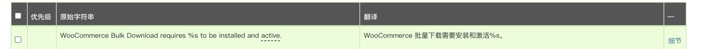
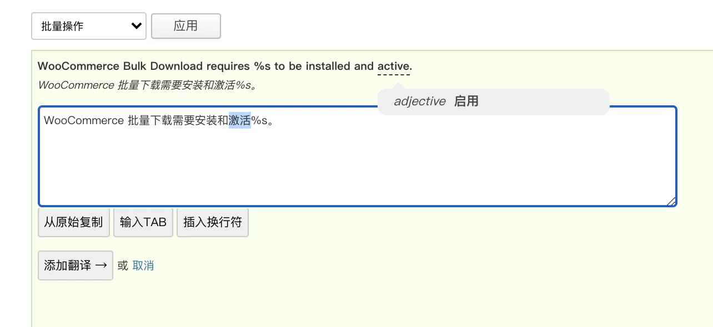
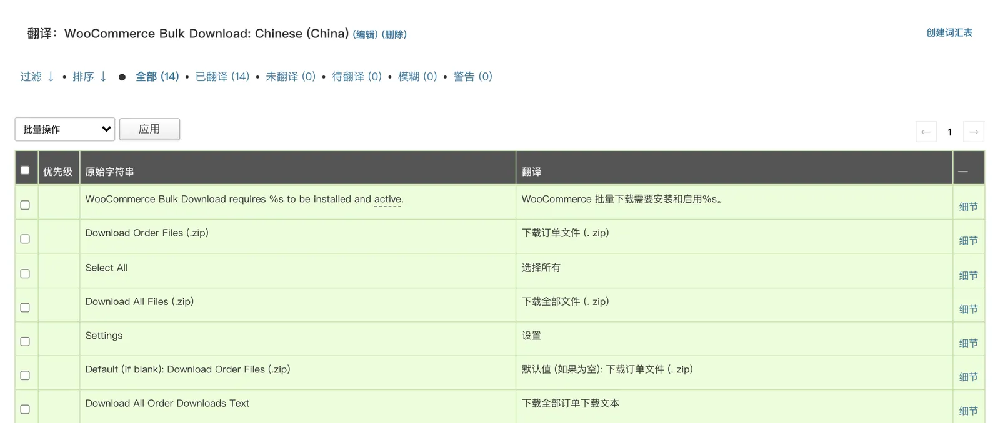
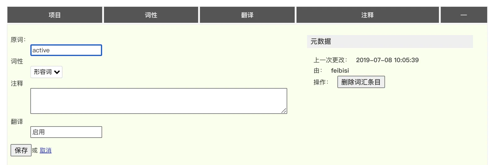
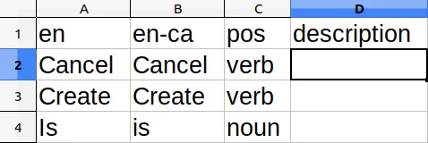

### 13.1 词汇表

GlotPress 中的词汇表是一种在多个翻译中使用的通用术语，以便一致使用的方式。例如，如果翻译人员不熟悉特定行业或知识领域的细节，他们通常很难理解技术术语或缩写。
词汇表为翻译人员提供了在翻译过程中可能有用的附加信息。例如，如果术语“创建”包含在词汇表中，您会在包含它的任何条目的翻译列表中看到它突出显示：

然后，当您展开条目时，您将再次看到它带有下划线，如果将鼠标悬停在它上面，则会获得更多详细信息：

这为翻译人员提供了额外的细节，可能有助于保持术语一致或提供更多细节以帮助翻译条目。

### 13.2 创建词汇表

默认情况下，不会为语言环境创建词汇表，但很容易添加。只需转到当前没有的任何语言环境，在右侧您将看到“创建词汇表”选项：

这将带您进入创建页面。您可以在此处向词汇表添加可选说明。
创建后，您可以开始向其添加术语。

### 13.3 添加术语表

进入词汇表页面后，您可以通过提供的 UI 添加术语：

在“创建条目”下，有四个字段需要填写：

1. 原始术语：这是您想要词汇表条目的术语，它始终使用您项目的源语言（通常是“en”）。
2. 词性：这是词的词性，可以是。您可以从下拉菜单中选择此项。
3. 翻译：这是针对该语言环境的原始术语的翻译。
4. 评论：这是一个自由形式的条目，允许您向译员提供附加信息。这是唯一的可选字段。

填写所需的详细信息后，您可以单击“创建”按钮，您的条目将被添加到词汇表中。
请注意，您可以为同一个原始术语创建多个条目，只要它们具有不同的词性即可。

### 13.4 导入术语表

您可以在 GlotPress 之外创建词汇表术语并将它们作为 CSV 文件导入。在语言环境的词汇表页面上，您可以选择“导入”链接，该链接位于页面底部附近的“创建”按钮下。
查看 CSV 格式的一种简单方法是创建一些词汇表条目，然后将它们导出，如下一节所述。
CSV 文件的格式如下：

标题行

- - 第 1 列 – 原始术语语言环境：原始术语语言环境标题列必须包含源字符串所在的有效语言环境代码。请注意，这几乎总是“en”。
  - 第 2 列 – 翻译语言环境：翻译语言环境标题列必须包含词汇表条目所针对的有效语言环境代码。请注意，您不能在单个导入文件中包含多个目标语言环境。
  - 第 3 列 – 词性列：词性标题列。这应该只包含一个值：pos。
  - 第 4 列 – 描述列：描述标题列。这应该只包含一个值：description。

数据行

- - 第 1 列 – 原始术语：必须在原始术语列下输入源语言环境的相应词汇表条目。
  - 第 2 列 – 翻译：必须在翻译列下输入目标语言环境的相应词汇表条目。
  - 第 4 列 – 词性列：词性是一个信息字段，指示应使用行中术语的含义。示例词性包括形容词、副词、名词 和 动词。
  - 第 5 列 - 说明栏：说明应为译员提供任何注释，包括行中术语的含义。

例如：

CSV 注释：

- 空白行被忽略。
- 单元格中的逗号必须用双引号 (") 转义。例如，添加术语 hello, world! ，使用“您好，世界！” . 引号内的引号由 \ 转义。例如， 她说，“您好。”  应输入为“她说，\”您好。\””。
- CSV 文件应为 UTF-8 格式。

### 13.5 导出术语

如果您想进行一些批量编辑或将其导入到另一个 GlotPress 安装中，导出您当前的词汇表可能会很有用。
在语言环境的词汇表页面上，您可以选择“导出为 CSV”链接，该链接位于页面底部附近的“创建”按钮下。
这将为给定词汇表中的所有条目创建一个 CSV 文件，并允许您下载它。
